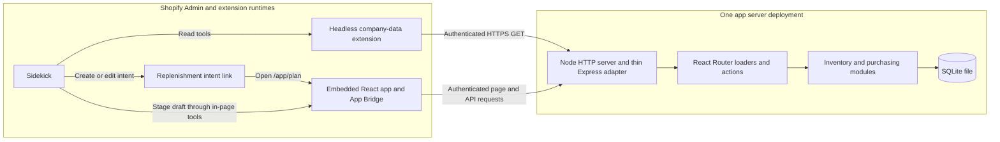
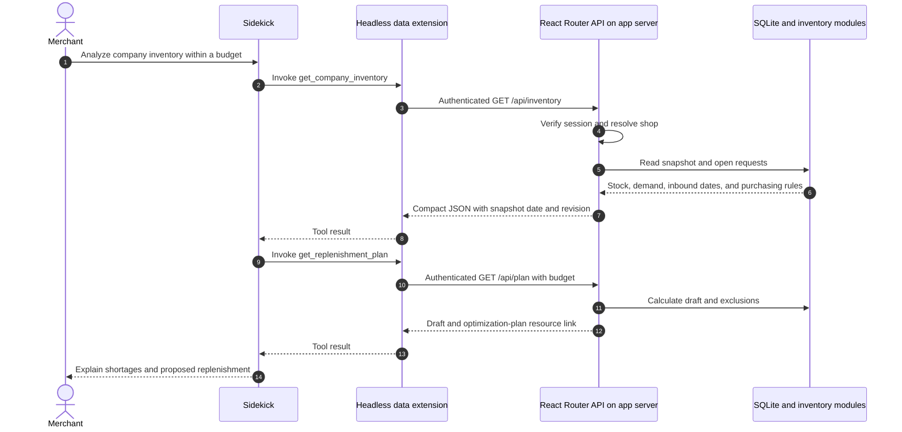
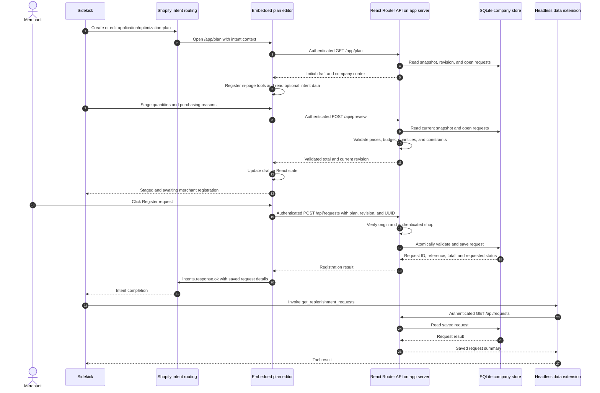

# Application Architecture

This sample demonstrates how a merchant can use Sidekick to analyze company data, prepare a replenishment plan, and save a purchasing request outside Shopify. One Node.js server hosts the embedded app, JSON endpoints, business logic, and SQLite access. The dummy company system is an internal module backed by a local database file.

The app uses React Router Framework Mode, TypeScript, Polaris web components, and Shopify's official React Router authentication library. Its application code is authored directly rather than generated from a Shopify CLI app template. Shopify CLI is used to develop and deploy the extensions; the app server also runs independently of the CLI.

## Runtime Map

| Area | Runs in | Responsibility |
| --- | --- | --- |
| `server.mjs` | App server, one Node.js process | Start HTTP, serve built assets or Vite middleware, handle health checks and CORS preflights, and dispatch requests to React Router |
| React Router `loader` and `action` functions | Same app server | Authenticate requests, read company data, validate submissions, and return page data or JSON |
| React route components | Server for initial rendering; merchant browser after hydration | Display inventory, hold an editable draft, and submit merchant actions |
| `app/lib/*.server.ts` | Same app server | Inventory calculations, purchasing validation, SQLite persistence, authentication, and Shopify session storage |
| App Bridge and Polaris web components | Embedded merchant browser inside Shopify Admin | Provide authenticated app fetching, intent context, tool registration, and UI components |
| `company-data` extension | Shopify-hosted headless browser sandbox | Register read-only tools that fetch data from the app server |
| `replenishment-plan` extension configuration | Shopify's intent routing | Declare which create/edit intents open the app's plan editor and which in-page tools are available |
| Sidekick | Shopify | Interpret merchant requests, analyze tool results, and invoke the app's declared tools and intents |
| SQLite | File on the app server's filesystem | Store company snapshots, requests, audit events, and Shopify sessions without a separate database service |

Express provides the HTTP adapter, static asset delivery, `/healthz`, and `OPTIONS /api/*`. Page routes and business APIs are implemented with React Router. During development, Vite runs as middleware in the same process and attaches hot reload to the same HTTP server.

The headless extension is delivered by Shopify and executes in its sandbox. It is not a second merchant-operated server. Likewise, the company data is external to Shopify's data model but remains in the sample's single SQLite file.

## Authentication and Data Ownership

In Shopify mode, [`app/shopify.server.ts`](../app/shopify.server.ts) configures `@shopify/shopify-app-react-router` for embedded authentication, Shopify-managed installation, and token exchange, as required by the [Sidekick app-data integration](https://shopify.dev/docs/apps/build/sidekick/build-app-data). [`authenticateRequest()`](../app/lib/auth.server.ts) delegates request verification to `authenticate.admin()`.

App Bridge supplies authentication for app-server fetches from the embedded browser. Shopify supplies app-authenticated fetches for the headless extension. Both paths resolve a verified session before the app reads company data. The app derives the tenant from `session.shop`; callers cannot choose another tenant with a request parameter. Online sessions also supply the staff identity recorded on registered requests, with the session ID as a fallback.

The SQLite session adapter stores authentication state in the same database as the dummy company system. Secrets, access tokens, database access, and purchasing validation remain in server-only modules. Route modules can contain both server and browser code: their `loader` and `action` run on the server, while their React component is hydrated in the browser.

The configured Shopify data scopes are empty because the sample reads its own company data. It does not read or update Shopify inventory through the Admin API. Distribution and installation are configured for the app in Shopify's dashboard.

## Reading Company Data from Sidekick

The [`company-data` extension](../extensions/company-data/shopify.extension.toml) targets `admin.app.tools.data`. Its default module registers three tools:

| Tool | Endpoint | Result |
| --- | --- | --- |
| `get_company_inventory` | `GET /api/inventory` | Availability, daily sales averages, dated inbound shipments, shortage forecasts, supplier constraints, and purchasing rules |
| `get_replenishment_plan` | `GET /api/plan?budget=...` | A calculated draft, budget exclusions, and a resource link to the optimization plan |
| `get_replenishment_requests` | `GET /api/requests` or `GET /api/requests?id=...&offset=...` | Recent request summaries or a page of saved purchasing lines |

These tools do not register requests or change purchasing data. Initial access lazily seeds a shop's dummy company snapshot, and authentication can store or refresh a session; those initialization operations are separate from purchasing mutations.

The plan response includes a `resource_link` with URI `gid://application/optimization-plan/replenishment` and MIME type `application/optimization-plan`. This matches the intent type in the action-link extension. The identifier refers to the sample's planning entry point; the returned draft is calculated on demand and is not a persisted editable plan.

Data responses use summaries rather than the raw 600 daily sales records. Request lists contain the ten most recent summaries. Request detail responses contain five lines per page, a `nextOffset`, and reasons shortened to 260 characters. The requests page displays the full saved text. These bounds keep tool responses small for Sidekick's documented response limits.

## Staging a Plan and Registering a Request

The [`replenishment-plan` extension](../extensions/replenishment-plan/shopify.extension.toml) targets `admin.app.intent.link`. It declares `create` and `edit` intents for `application/optimization-plan`, both opening `/app/plan`.

The editor reads `shopify.intents.request.value` and subscribes to updates. Optional intent data fills the draft in React state. The plan identifier can be transported as the `planId` query parameter; other declared input fields use hash transport. The editor accepts the sample's `replenishment` identifier and its full GID.

While the editor is mounted, it registers the tools declared in [`tools.json`](../extensions/replenishment-plan/tools.json):

| In-page tool | Behavior |
| --- | --- |
| `stage_replenishment_plan` | Replace draft lines and optionally update title, summary, or budget; validate through `/api/preview` before staging |
| `update_replenishment_line` | Change the quantity or reason of an existing draft SKU; validate through the same preview endpoint |
| `get_staged_replenishment_plan` | Read the current draft and registration state; optionally read a single SKU's full reason |

Tool handlers are removed when the editor unmounts. None of these handlers calls the registration endpoint. Manual edits and intent input also remain in the form until the merchant clicks **Register request**.

Preview checks do not save a request. Registration validates the latest state again, so a successful preview does not bypass a later revision change or an existing open request. Cancelling an active intent calls `intents.response.closed()`; outside an intent, Cancel restores the initial draft. Neither cancellation path registers a request.

After registration, the editor remains on the same route and reports completion through `intents.response.ok()`. A failed completion notification does not undo the already-saved request. Navigation to another pathname can close an [intent workflow](https://shopify.dev/docs/apps/build/sidekick/build-app-actions), so the save operation does not redirect to the history page.

## Company Data and Inventory Processing

[`company-data.ts`](../app/lib/company-data.ts) creates a reproducible snapshot dated **2026-10-06**: 20 products, Tokyo and Osaka warehouses, three suppliers, 30 daily sales records per product, and a confirmed inbound shipment. Each authenticated shop receives its own copy.

[`inventory.server.ts`](../app/lib/inventory.server.ts) performs the server-side calculations:

- Available stock is total on-hand stock minus reserved units across both warehouses.
- Daily demand is the total sales in the previous 30 calendar days divided by 30.
- The shortage forecast simulates 60 days, adding confirmed arrivals at the start of their arrival day before subtracting demand.
- Standard arrival includes supplier lead time and any known delay. A shortage before that arrival is marked as requiring expedited delivery.
- Replenishment quantities cover lead time plus the 14-day target, deduct available stock, applicable confirmed inbound quantities, and pending request quantities, then round up to supplier minimums and pack sizes.
- Initial recommendations consider urgent/watch products without an open request, prioritize the earliest projected stockouts, and select complete replenishment lines that fit the remaining budget. The default budget is JPY 100,000; the maximum per-request budget is JPY 200,000.

The initial plan is deterministic. Sidekick can analyze the returned data and revise quantities and reasons in the editor; the Node.js server does not call an LLM provider. Local demo mode therefore offers the same calculation and registration UI without simulating a Sidekick conversation.

A registered request has status `requested`. It represents a purchasing instruction in the dummy company system. It does not establish supplier acceptance, create a confirmed inbound shipment, change on-hand stock, or guarantee that a shortage will be prevented. Pending quantities reduce recommended replenishment but do not delay the shortage forecast.

## Persistence and Registration Guarantees

[`database.server.ts`](../app/lib/database.server.ts) uses Node's built-in `node:sqlite` API. It creates tables on first use, enables WAL mode and a busy timeout, and keeps one connection per Node process, including across Vite module reloads.

| Table | Stored data |
| --- | --- |
| `company` | Shop-specific JSON snapshot and revision |
| `requests` | Saved request JSON, server-calculated prices, UUID submission key, and content fingerprint; keys are scoped to the shop |
| `audit` | Successful request creation and dummy-data reset events, including actor and timestamp |
| `sessions` | Shopify sessions serialized by the SQLite session-storage adapter |

Registration first parses the submission with Zod, then executes a `BEGIN IMMEDIATE` transaction:

1. Look for the same submission key within the authenticated shop. A matching fingerprint of the normalized plan and submitted revision returns the existing result before checking the current revision. Reusing the key with different content returns a conflict.
2. Compare the submitted revision with the current company revision. A stale form returns a conflict.
3. Validate known and unique SKUs, positive quantities, non-empty reasons, minimum orders, pack sizes, existing open requests, and the budget. Prices come from the company snapshot, not from the browser.
4. Save the request, increment the company revision, and append the creation audit event.
5. Commit the transaction. An error rolls back its changes.

This allows safe retries after a lost response while preventing stale forms and duplicate procurement for a SKU with an open request. The browser preserves its submission key for an unchanged retry and creates a new key after draft changes.

Reset deletes the shop's dummy requests and audit history, restores its fixed snapshot, increments the revision, and records a reset event. It leaves Shopify sessions intact. A verified `app/uninstalled` webhook deletes that shop's sessions, requests, audit events, and company snapshot.

## HTTP Route Map

| Method and path | Responsibility | Source |
| --- | --- | --- |
| `GET /` | Redirect to `/app` | [`home.tsx`](../app/routes/home.tsx) |
| `GET /app` | Inventory dashboard and authenticated app layout | [`inventory.tsx`](../app/routes/inventory.tsx), [`app.tsx`](../app/routes/app.tsx) |
| `GET /app/plan` | Load the draft editor and register its browser-side tools | [`plan.tsx`](../app/routes/plan.tsx) |
| `GET /app/requests` | Full saved requests and recent audit history | [`requests.tsx`](../app/routes/requests.tsx) |
| `GET /api/inventory` | Compact inventory and purchasing context | [`api.ts`](../app/routes/api.ts) |
| `GET /api/plan` | Draft and resource link; optional `budget` | [`api.ts`](../app/routes/api.ts) |
| `GET /api/requests` | Recent summaries, or details selected by `id` and `offset` | [`api.ts`](../app/routes/api.ts) |
| `POST /api/preview` | Validate a plan and return its total and current revision | [`api.ts`](../app/routes/api.ts) |
| `POST /api/requests` | Validate and register a merchant-submitted request | [`api.ts`](../app/routes/api.ts) |
| `POST /api/reset` | Reset dummy data after the `RESET` confirmation | [`api.ts`](../app/routes/api.ts) |
| `GET /auth/*` | Delegate the authentication route to Shopify's library | [`auth.ts`](../app/routes/auth.ts) |
| `POST /webhooks/app/uninstalled` | Verify the webhook and delete shop-specific data | [`uninstalled.ts`](../app/routes/uninstalled.ts) |
| `GET /healthz` | Return process health without Shopify authentication | [`server.mjs`](../server.mjs) |
| `OPTIONS /api/*` | Respond to Shopify extension sandbox preflights | [`server.mjs`](../server.mjs) |

All purchasing API operations authenticate the request. Writes additionally require the app's own origin, including preview calls. The server answers preflights for `https://extensions.shopifycdn.com`, and API responses use the authentication library's CORS helper. Preflight permission does not grant purchasing write access to the data extension. JSON API responses use `Cache-Control: no-store`.

## Local Demo and Deployment

| Mode | Authentication and runtime |
| --- | --- |
| Local demo | Explicit `DEMO_MODE=true`; listener binds to `127.0.0.1`, request host must be loopback, and the app uses a fixed demo shop and actor. Polaris loads, while Shopify authentication, App Bridge, and Sidekick tool registration are disabled. |
| Shopify app | Requires app credentials, a public HTTPS app URL, installation on a Shopify store, and deployed extensions. The app loads App Bridge and authenticates page and API requests through Shopify's library. |

The local UI starts with `pnpm run dev:demo`. For a built local demo, run `pnpm run build` followed by `pnpm run start:demo`. Normal Shopify mode uses `pnpm run dev` or a build followed by `pnpm run start`. Node.js 22.13 or later is required by the project.

The default database path is `./data/company.sqlite`. [`render.yaml`](../render.yaml) defines one Node web service with a persistent disk mounted at `/var/data` and `DATABASE_PATH=/var/data/company.sqlite`. The disk preserves company data, requests, and sessions across server restarts. The sample assumes a single app instance using this local file.

Hosting the Node server and deploying Shopify extensions are separate deployment operations. Shopify CLI is not required to start the hosted application process. Configure matching credentials and URLs in [`.env.example`](../.env.example) and [`shopify.app.toml`](../shopify.app.toml); the committed client ID and domain are placeholders. Actual Sidekick integration requires that setup and has not yet been verified against an installed store.

## Source Map

| Concern | Source |
| --- | --- |
| Route definitions | [`app/routes.ts`](../app/routes.ts) |
| HTTP startup and middleware | [`server.mjs`](../server.mjs) |
| HTML shell and server rendering | [`app/root.tsx`](../app/root.tsx), [`app/entry.server.tsx`](../app/entry.server.tsx) |
| Shopify library configuration | [`app/shopify.server.ts`](../app/shopify.server.ts) |
| Authenticated shop and write-origin checks | [`app/lib/auth.server.ts`](../app/lib/auth.server.ts) |
| Shopify session persistence | [`app/lib/session-storage.server.ts`](../app/lib/session-storage.server.ts) |
| Fixed company snapshot | [`app/lib/company-data.ts`](../app/lib/company-data.ts) |
| Forecasts, recommendations, and purchasing validation | [`app/lib/inventory.server.ts`](../app/lib/inventory.server.ts) |
| Input schemas and submission contract | [`app/lib/plan.ts`](../app/lib/plan.ts) |
| SQLite transactions and tenant-scoped data | [`app/lib/database.server.ts`](../app/lib/database.server.ts) |
| JSON response/error helpers and browser fetches | [`app/lib/http.server.ts`](../app/lib/http.server.ts), [`app/lib/client.ts`](../app/lib/client.ts) |
| Sidekick data tool declarations and handlers | [`extensions/company-data/tools.json`](../extensions/company-data/tools.json), [`src/index.ts`](../extensions/company-data/src/index.ts) |
| Sidekick intent and in-page tool declarations | [`extensions/replenishment-plan/shopify.extension.toml`](../extensions/replenishment-plan/shopify.extension.toml), [`intent-schema.json`](../extensions/replenishment-plan/intent-schema.json), [`tools.json`](../extensions/replenishment-plan/tools.json) |
| Domain and persistence verification | [`tests/company.test.ts`](../tests/company.test.ts) |

## Official References

- [Use extensions to surface app data](https://shopify.dev/docs/apps/build/sidekick/build-app-data)
- [Use extensions to surface app actions](https://shopify.dev/docs/apps/build/sidekick/build-app-actions)
- [App Bridge Intents API](https://shopify.dev/docs/api/app-home/v1.0/apis/user-interface-and-interactions/intents-api)
- [Shopify App React Router library](https://shopify.dev/docs/api/shopify-app-react-router/latest)
